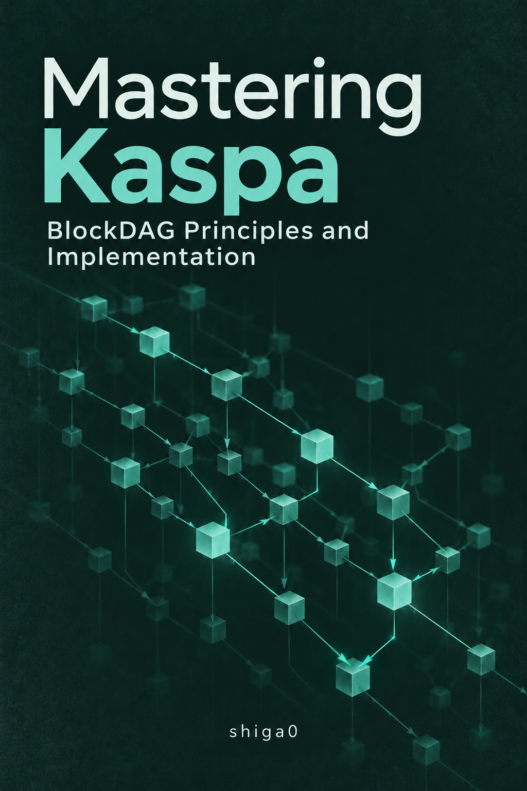

# Mastering Kaspa — BlockDAGの原理と実装

<a href="https://shiga0.github.io/mastering-kaspa/">
  
</a>

Kaspaの基礎から、BlockDAG、GHOSTDAG、コンセンサス、Rustによる実装、アプリケーション開発までを体系的に学ぶための技術書です。

**[オンラインで読む](https://shiga0.github.io/mastering-kaspa/)**

> **執筆・技術検証中（Draft）**
>
> 本書には未検証の説明や実行確認前のコードが含まれています。重要な内容は必ず一次資料と照合してください。

## この本の目的

- Kaspaの仕組みを「概念 → 原理 → 設計 → 実装 → 検証」の順に理解する。
- 論文・KIP・`rusty-kaspa`のソースコードを関連づけて学ぶ。
- Rustによる最小実装と再現可能な実験を通じて理解を深める。
- 学習・調査・検証の過程を記録し、コミュニティに共有する。

## 想定読者と最初の実習

Kaspaの仕組みを理解し、SDK・RPCを使ったアプリ開発や、公式実装の調査へ進みたいエンジニアを想定しています。実装編では、Rustの基本文法・所有権と借用・`Result`・trait・単体テストに加え、ターミナル操作とネットワークの基礎を使います。

まず動かしたい場合は、[「はじめに」の最初の実習ルート](src/introduction.md#まず動かしたい方へ)へ進んでください。付録Aで前提を確認し、第28章の環境準備から公式SDKの監視サンプルへ進むと、ローカルDevnetのUTXO通知と再接続後の再照会を試せます。DockerとNode.jsを使い、既存のDocker構成はlinux/arm64専用です。

## 書籍構成

| Part | テーマ | 章 |
| --- | --- | --- |
| I | Foundations | 1〜8 |
| II | Consensus | 9〜14 |
| III | Transactions, Mining & Security | 15〜20 |
| IV | Kaspa Development & Implementation | 21〜28 |
| V | Advanced Kaspa Topics（Silverscript・Argentを含む） | 29〜34 ＋ 独立ページ「Argent」 |
| VI | Building & Contributing | 35〜36 |
| Appendices | 環境構築・用語集・参考文献など | A〜H |

Part Vでは、Covenants、Silverscript、**Argent（Actorベースのアプリケーション言語）**、Layer 2、vProgsなどを扱います。Argentは独立した補足ページにまとめています。

表紙から「読み始める」で本文へ進めます。各Partの扉ページに学ぶ内容・前提知識・各章への案内を、付録の扉ページに目的別の参照先をまとめています。詳細な目次は `src/SUMMARY.md` を参照してください。

## ローカルで読む

本書はmdBookを使用しています。

mdBookのインストール：

```bash
cargo install mdbook --version 0.5.4 --locked
```

ローカルでプレビュー：

```bash
mdbook serve --open
```

HTMLの生成：

```bash
mdbook build
```

基準ソースは `rusty-kaspa` v1.0.1、実習はDevnetです。[対象バージョンと確認範囲](src/baseline.md)に、SDK・Rust・Dockerイメージの対応と既存原稿の版差をまとめています。

## 実行できるサンプル

[第27章の最小ノード](examples/minimal-node/README.md)を掲載しています。標準ライブラリのみで実行でき、16件の単体テストを含みます。

[第12章のDAG解析器](examples/dag-relations/README.md)も収録し、Past・Anticone・k-cluster条件と追加順の違いを検証しています。

[公式SDKのDevnet監視サンプル](examples/sdk-monitor/README.md)では、Node.js/WASM SDK v1.0.1を使って接続・情報取得・UTXO通知受信・切断と再接続を実行できます。第28章28.6.4に手順と実APIの説明を掲載しています。

[第35章の入金候補への変換サンプル](examples/payment-candidates/README.md)では、公式SDKの現在UTXOをJSON経由でRustの集計モデルへ取り込みます。保存済みの実データでも実行でき、UTXOの観測と請求の支払い済み判定を分けています。

[第32章のSilverscript/VM実習](experiments/silverscript-vm/README.md)では、2-of-2、期限付き返金、状態更新、後継UTXOの系列制約について、正常系と失敗ケースの計30件を検査できます。Rust 1.94.0と別の固定Kaspa依存を使う手動のローカル実習で、ネットワークへの送信は行いません。

完成したウォレット・報酬アプリは本書の収録対象外です。HD復旧・送金などの限定した検証コードと記録は `experiments/` に保存しています。

章・付録別の確認範囲と既知の制限は[技術レビューの進捗](src/review-status.md)を参照してください。

Devnetの起動・読み取りwRPC・再起動の検証手順は[Devnet実習](experiments/devnet/README.md)を参照してください。公式WASM SDKによる単一署名送金とvirtual受理まで確認済みです。所定の送金異常系、2ノードの伝播・停止復帰・分断合流も確認済みです。Pruning後IBD、競合送金の再編成と会計処理は未検証です。

初版の編集範囲と今後の検証課題は[ROADMAP](ROADMAP.md)にまとめています。

## 原稿の状態

各章の状態を次のように区別します。

- **Draft**：公開中・改訂中の原稿。レビュー済みの範囲と未検証部分は進捗表に記録。

技術的な記述の検証状態は、付録Hの基準に合わせて記録します。

- **Verified**：個別の主張を固定資料・実装と必要な試験で確認。対象条件と限界を明記。
- **Source-checked**：対象範囲の固定ソースと使用箇所を照合。実行の有無・結果は別に記録。
- **Literature-checked**：引用する論文・KIPの要旨/節を確認。実装・有効化の確認とは別。
- **Metadata-checked**：題名・著者・版・Status等のみを確認。内容や実装の検証とは別。
- **Illustrative**：教育用の擬似コード・模式図。
- **Unverified**：根拠・検証が不足。
- **Deprecated**：古い仕様・非推奨。

章の執筆状態（Draft）と、個々の説明・コードの検証状態は分けて扱います。

初稿があることは、技術的な正確性やコードの動作を保証するものではありません。特に開発中の技術は、仕様・実装・メインネットでの利用可否を区別して記載します。

## 一次資料

- [Kaspa公式サイト](https://kaspa.org/)
- [Kaspa Wiki](https://wiki.kaspa.org/)
- [Kaspa Improvement Proposals（KIPs）](https://github.com/kaspanet/kips)
- [rusty-kaspa](https://github.com/kaspanet/rusty-kaspa)
- [Argent](https://github.com/argent-lang/argent)

## ライセンス・コントリビューション

本文・図・検証記録は **CC BY 4.0**、自作コードと本文中のコード例・設定例は **MIT** で提供します。外部由来の資料・コードには元の条件を維持します。適用範囲と条文は [LICENSE](LICENSE) を参照してください。

誤字・説明の改善・技術的な訂正をIssue／PRで受け付けます。大きな変更は事前にIssueで相談してください。投稿手順とライセンスは [CONTRIBUTING.md](CONTRIBUTING.md) にまとめています。

メンテナー向けの[参考リポジトリ・追跡ブランチと更新方針](docs/editorial-guide.md#参考リポジトリの更新を追う)も記載しています。

---

**Status:** Draft / 公開中・改訂中・検証範囲に制限あり

**Language:** 日本語（将来的に英語版も検討）

## 本文とサンプルの同期検査

```bash
python3 scripts/check-book-examples.py
```

第12章・第27章・第35章の `example:…:start/end` コメントで囲んだ範囲からRustコードを取り出し、対応するサンプルと比較します。第35章の対象は集計モデルとtrait定義です。サンプルを修正したら本文も更新してください。同期検査はCIでも実行します。
